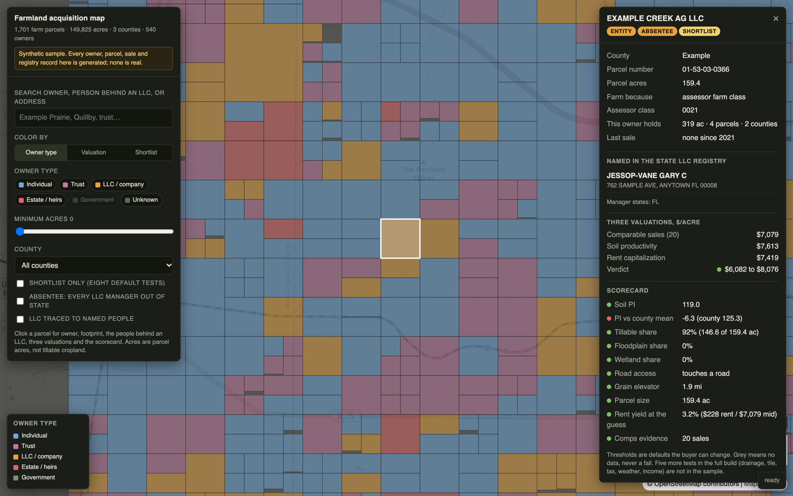
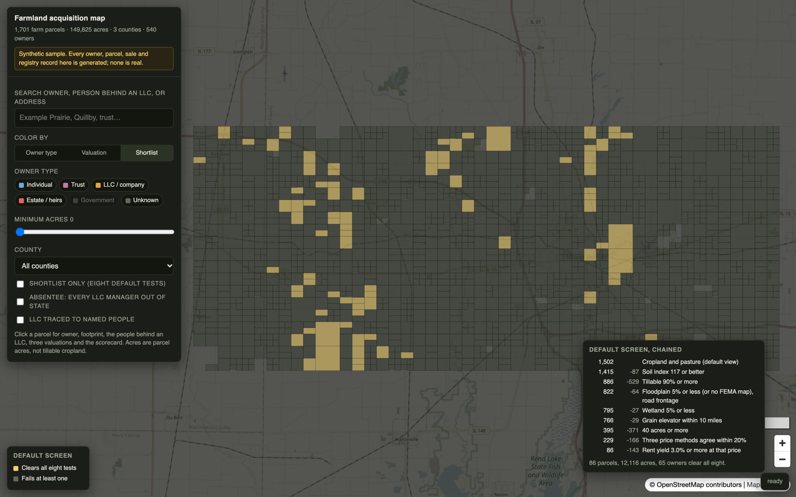
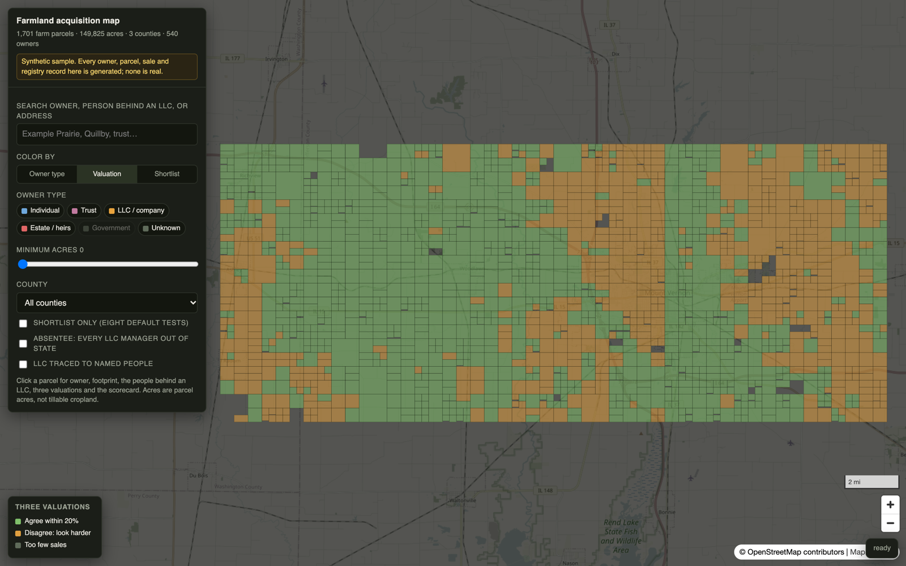
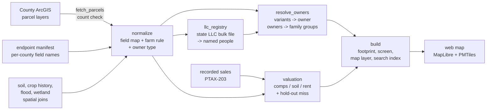

# Farmland acquisition map

An acquisition intelligence platform that identifies, values, screens and prioritizes farmland before it reaches the market, built entirely from free public records.



*All screenshots run on the synthetic sample in this repo. Every owner, parcel, sale and registry record in them is generated.*

> **About this repo.** This is a public snapshot of a private application. The private version runs on real statewide data and is updated continuously: new counties, sources, rules and valuation changes land there first. This copy is fixed at the point it was published. It keeps the core pipeline, the rules and the map, runs them on a synthetic sample, and is not updated alongside the private app.

## The problem

Farmland often changes hands without a listing. It passes into a trust or an LLC and sells to a neighbor or a relative. A buyer who waits for the listing competes on price. A buyer who already knows the parcel, the owner and a fair value reaches the owner first.

For every parcel, four questions stand in the way:

1. Who owns it, and who stands behind the LLC or trust on the deed?
2. How much of it is real cropland on good soil?
3. What is it worth on sales, on soil and on rent?
4. Does it fit what the buyer wants?

The answers are public, but they are scattered across county assessors, the state LLC registry, USDA crop and soil maps, FEMA flood maps and recorded sales. Data vendors sell them per county or per state, cover some counties and stop at the LLC name on the deed.

## What it does

- **Maps every farm parcel** from free county parcel layers, with one farm rule applied everywhere and each county's row count checked against the county's own published total.
- **Resolves owners.** Name variants collapse into one owner ("EXAMPLE FARMS LLC", "EXAMPLE FARMS L.L.C.", "EXAMPLE FARMS LLC C/O ..."), owners link into family and control groups, and each owner's total acres and counties show on every parcel.
- **Traces LLCs to named people** through the state's free bulk LLC registry, and flags absentee owners whose managers all live out of state.
- **Values each parcel three ways** (comparable sales, price per soil point, capitalized rent) and keeps them separate. Where they disagree, the parcel is flagged instead of averaged.
- **Screens and ranks** with a scorecard of plain tests (soil, tillable share, flood, wetland, road, elevator distance, size, price agreement, rent yield). Thresholds are the buyer's to set. Missing data shows grey, never as a fail.
- **Shows its gaps.** A missing source is a visible gap on the map, not a guess.

| Shortlist view: parcels that clear eight default tests | Valuation view: where the three methods agree or split |
|---|---|
|  |  |

## How it works



| Stage | File | What it does |
|---|---|---|
| Fetch | `pipeline/fetch_parcels.py` | Pages through each county's ArcGIS layer. If offset paging comes up short, it refetches by object id, which cannot skip rows. A county that does not match its published count is never marked done, so the next run retries it. |
| Normalize | `pipeline/normalize.py` | Reads each county's field names from the manifest (owner can be `Owner`, `OWNER_NAME`, or split across surname and first-name columns) and projects every parcel into one schema. Fails the build if any county's row count is off. |
| Owner type | `pipeline/owner_type.py` | Types the free-text owner as person, trust, entity, estate or government. Handles the traps: REAL ESTATE is a trade word, a LIFE ESTATE tenant is alive, LODGE and COOP are also surnames, a care-of farm manager is not the owner. |
| Farm rule | `pipeline/farm_rule.py` | One definition of farmland, imported everywhere. Strongest evidence first: assessor crop acres, assessor farm class, 12-year satellite crop history, size. A firm non-farm class (residential, exempt) overrides the weak signals. |
| LLC registry | `pipeline/llc_registry.py` | Joins farmland LLCs to the fixed-width state registry files. A name that matches two registry file numbers gets no people at all, because the file carries no status and guessing would attach strangers to the land. |
| Owner resolution | `pipeline/resolve_owners.py` | Exact canonical core, then word order, then Jaro-Winkler with a token guard. Short names and fuzzy matches also need a shared county, mailing address or registry file. A company never merges with a trust. Every merge and refusal is logged with its reason. |
| Valuation | `pipeline/valuation.py` | Weighted median of the 20 nearest comparable sales (distance, soil and recency weights, carried to today by a district price index), $ per soil point, and rent over the local cap rate. A leave-one-out hold-out measures how far off the comps method runs. |
| Screen | `pipeline/screen.py` | Eight default tests chained over the cropland view, reported as a funnel. |
| Build | `pipeline/build.py` | Runs all of the above and writes the map layer, the owner search index, the funnel and a shortlist CSV. |
| Map | `web/index.html`, `web/scorecard.js` | MapLibre front end: color by owner type, valuation or shortlist; filters; owner and LLC-person search; parcel panel with footprint, people, three values and the scorecard. |

`pipeline/sql/soil_overlay.sql` is the production spatial join that gives each parcel an area-weighted soil index. The sample ships those overlay values precomputed.

## Stack

- Python for the pipeline. The repo version uses the standard library only; `requests` is needed only to download real county layers.
- DuckDB with the spatial extension as the production warehouse, for the parcel, soil, flood and wetland overlays.
- tippecanoe and PMTiles for vector tiles, read by range requests from a static host. `serve.py` is a small static server that answers HTTP Range requests, which Python's built-in server does not.
- MapLibre GL JS for the map. No framework and no build step.
- Public data only: county parcel layers, the Illinois Secretary of State LLC file, USDA Cropland Data Layer, NRCS soil survey, FEMA flood maps, National Wetlands Inventory, PTAX-203 recorded sales, USDA NASS cash rents and grain elevator locations.

## Results

From the full build on real public data:

| | |
|---|---|
| Paid for data | **$0**. Sources catalogued: 1,195. Priced and declined: $6,000 for statewide parcels, $8,750 for one county's boundaries. |
| Parcels downloaded | 5,423,489 from 81 county parcel layers. In the first 22 counties, every count matched the county's own. |
| Farm parcels on the map | 529,213, covering 25.25 million acres |
| LLCs traced to named people | 13,425 of 20,497 farmland LLCs |
| Searchable variables per parcel | 108, plus a 15-test scorecard |
| Tillable acres and soil | 17.45 million tillable acres; a soil index on 528,650 parcels |
| Valuations | Three side by side on 517,857 parcels. They agree within 20% on 34%; the rest are flagged. |
| Tax estimate | On 367,608 parcels, median error 10.8% against real bills in one county |
| Recorded sales | 56,395 farm sale declarations; 15,709 in the comparable pool |
| Shortlist | **1,026 parcels, 91,873 acres, 853 owners** clear eight chained default tests |
| Rent yield | Median 2.35% on cropland and pasture where the prices agree |

The synthetic sample produces its own, much smaller funnel (printed by the build and shown on the map). Its numbers describe generated data and say nothing about real land.

## Where it breaks

- **Bank-held Illinois land trusts.** State law keeps the beneficiary off the public record, so the platform cannot name who stands behind one. Most trust-held farmland names a trustee on the deed, and that owner is reachable.
- **Owner matching is careful, not certain.** Matching on name, address and registry filings is not legal entity resolution. One person registered two ways can count twice.
- **The valuations screen; they do not price a bid.** In hold-out tests, comparable sales miss the real price by a median 22.6% against a 15% target, and 76 of the 80 counties tested carry a low-confidence flag shown on every parcel.
- **Coverage is uneven.** 21 of Illinois' 102 counties are not on the map yet. Some homes were counted as farmland; the fix is decided but not yet rebuilt.
- **Some sources are off limits.** Sites whose terms bar automated access are never fetched. Their counties show as gaps.
- **Seller motivation and adjacency scoring are not built yet.** The signals (estate owners, auctions, absentee managers, owner footprint) are on the map; the score that weighs them is not.
- **This repo is a subset.** It runs the same rules in plain Python on a synthetic three-county sample. The production build adds the DuckDB warehouse, the soil, crop, flood and wetland overlays at state scale, the tax and weather layers and a gated hosted map.

## Run it locally

Needs Python 3.10 or later. No packages to install for the sample.

```bash
python sample/make_synthetic.py        # regenerate the synthetic inputs (already committed)
python -m pipeline.build               # normalize, trace LLCs, resolve owners, value, screen
python serve.py                        # then open http://127.0.0.1:8787/web/
python -m unittest discover tests      # unit tests
```

Optional: `python -m pipeline.build --pmtiles` also builds vector tiles if `tippecanoe` is installed, and the map switches to them.

To point it at real data, write an endpoint manifest in the shape of `sample/manifest.json` and run `python -m pipeline.fetch_parcels --manifest your-manifest.json --out raw/`. Respect each county's terms of use.

The map opens a parcel from the URL: `http://127.0.0.1:8787/web/#pin=01-53-03-0366&z=12.4`, or a view with `#mode=value` or `#mode=short`.

## Case study

The full write-up, with the method, exhibits and limits: <https://dandoungroup.com/case-studies/#farmland>

## Author

Anthony Nader. Released under the MIT License.
